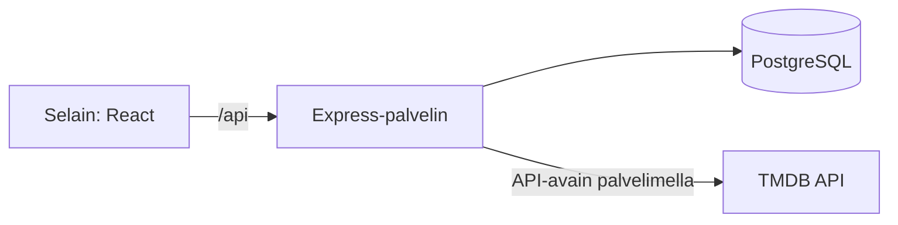

# Tekninen määrittely

Tila: luonnos. Päivitetään projektin edetessä.

## Teknologiat

- Frontend: React (Vite), react-router-dom
- Backend: Express (Node.js 24)
- Tietokanta: PostgreSQL 18
- Istunnot: express-session, tallennus tietokantaan (connect-pg-simple)'
- salasanat: bcrypt
- Elokuvatiedot: TMDB API (haku palvelimen kautta)
- Versionhallinta: GitHub
- Julkaisu: Azure App Service (Linux), Azure Database for PostgreSQL flexible server
- Paikallinen kehitys: Docker Compose

## Arkkitehtuuri

Tuotannossa Express tarjoilee sekä API:n että käännetyn Reactin (`client/dist`) samasta osoitteesta. Paikallisessa kehityksessä Vite-kehityspalvelin välittää `/api`-pyynnöt backendille.

## Hakemistorakenne

| Polku | Sisältö |
|-------|---------|
| `client/` | React-sovellus |
| `server/src/` | Express: `app.js`, `index.js`, `db.js` |
| `server/src/routes/` | API-reitit |
| `server/src/controllers/` | HTTP-pyyntöjen käsittely |
| `server/src/services/` | Tietokanta- ja ulkoisten rajapintojen kutsut |
| `server/src/middleware/` | Väliohjelmistot (esim. `requireAuth`) |
| `server/db/schema.sql` | Tietokannan skeema |
| `docs/` | Dokumentaatio |

## Tietokanta

Skeema: `server/db/schema.sql`. Kaavio: `docs/erd.md` ja `docs/schema.dbml`.

Istuntotaulu `user_sessions` luodaan ajonaikaisesti (`createTableIfMissing`), joten se ei ole `schema.sql`-tiedostossa.

## API

| Metodi | Polku | Kuvaus | Kirjautuminen |
|--------|-------|--------|---------------|
| GET | /api/health | Palvelimen tilan tarkistus | ei |
| GET | /api/health/db | Tietokantayhteyden tarkistus | ei |
| POST | /api/auth/register | Rekisteröinti | ei |
| POST | /api/auth/login | Kirjautuminen | ei |
| GET | /api/auth/me | Kirjautuneen käyttäjän tiedot | kyllä |
| POST | /api/auth/logout | Uloskirjautuminen | kyllä |
| GET | /api/movies/popular | Suositut elokuvat (TMDB) | ei, PR #69 |

## Tietoturva

- Salasanat tallennetaan bcrypt-hashina.
- SQL-kyselyt ovat parametrisoituja
- Istuntoeväste: `httpOnly`, `sameSite: lax`, `secure` tuotannossa. App Servicen proxyn takia `trust proxy` on käytössä.
- Salaisuudet (tietokanta, `SESSION_SECRET`, TMDB-avain) ovat ympäristömuuttujissa. `.env` ei mene GitHubiin.
- Ei vielä toteutettu: kirjautumisen ja rekisteröinnin rate limiting (S2), CSP (S3), kaksivaiheinen tunnistautuminen (S4).

## Käyttöönotto

- Push `main`-haaraan käynnistää GitHub Actions -workflowin `.github/workflows/main_movie-app-2026.yml`.
- Workflow asentaa riippuvuudet, ajaa `npm run build` ja vie paketin App Serviceen. Kesto noin 4 minuuttia.
- Azuren App settings: `NODE_ENV`, `DB_HOST`, `DB_PORT`, `DB_NAME`, `DB_USER`, `DB_PASSWORD`, `DB_SSL`, `SESSION_SECRET`, `VITE_TMDB_API_KEY`.
- Skeema ajetaan Azuren tietokantaan erikseen (DBeaver tai `psql`).
- Ohjeet: README.md.
